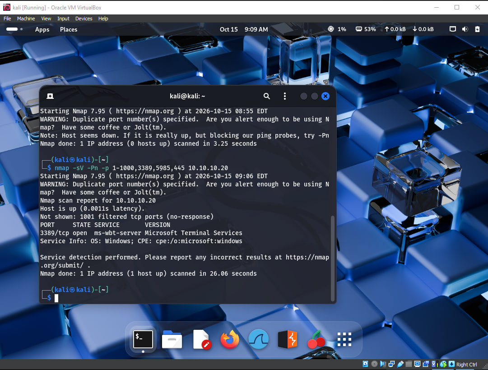
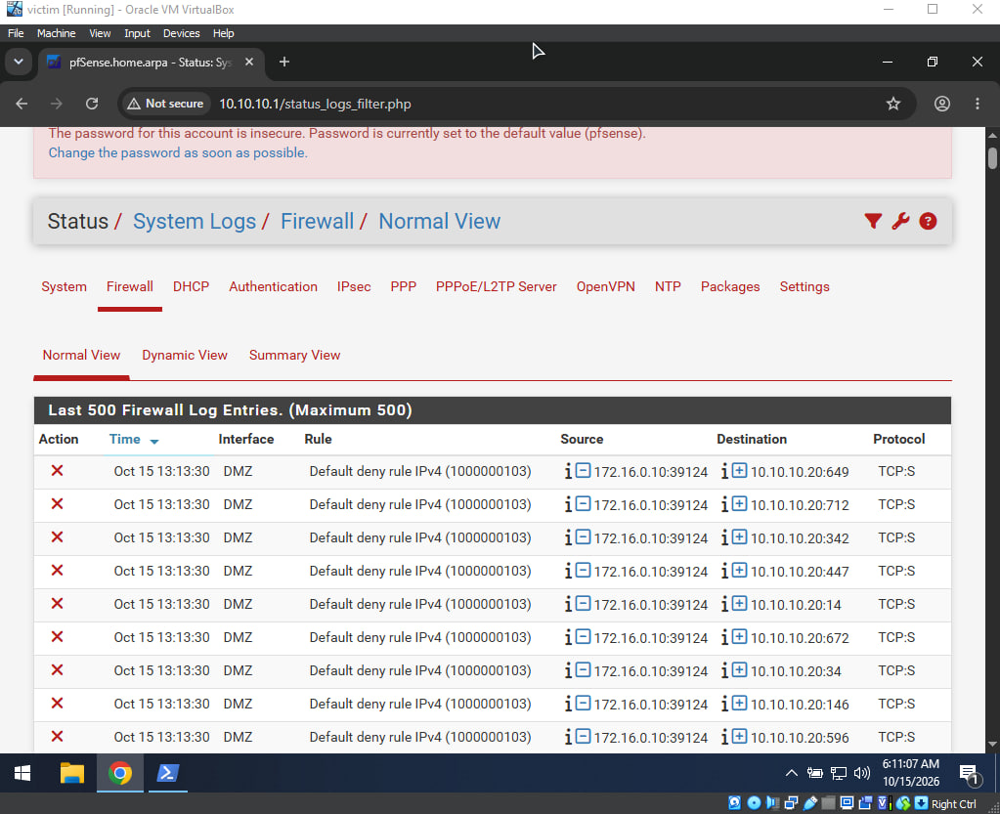
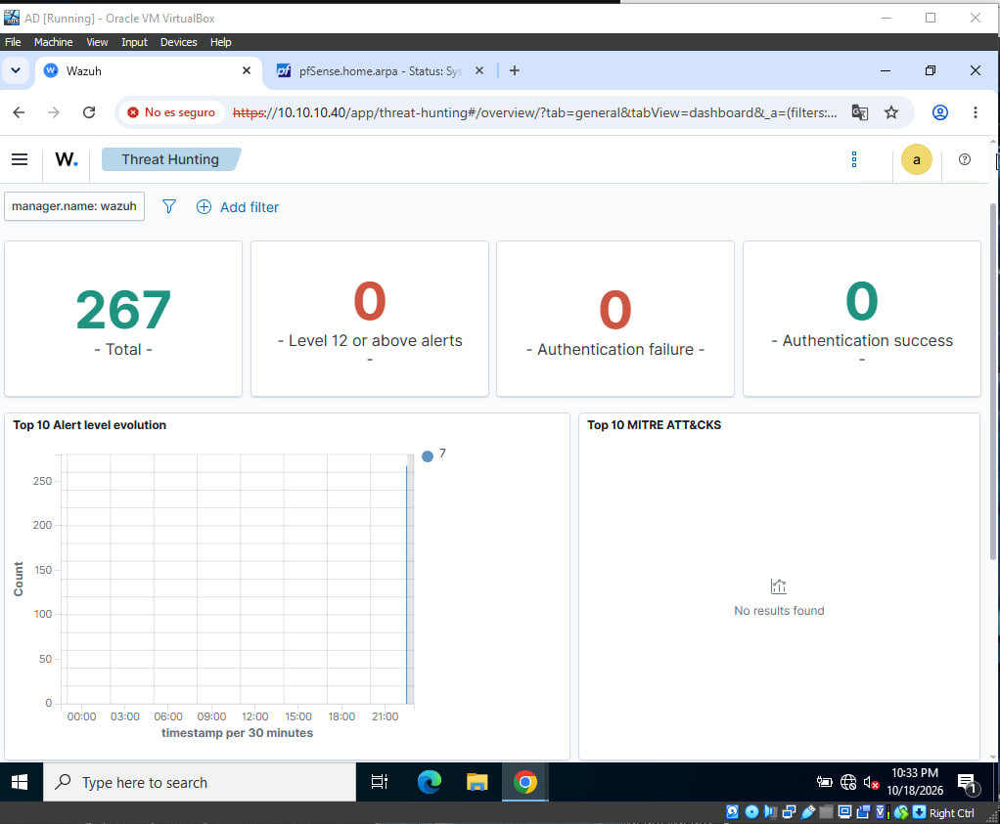
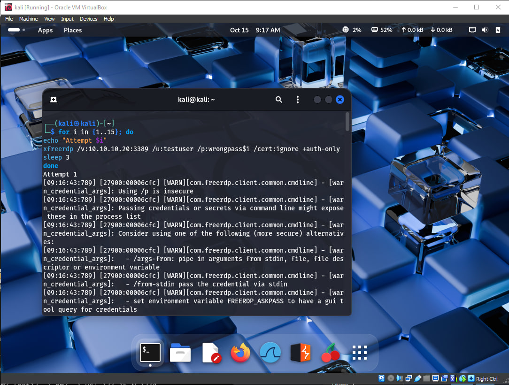
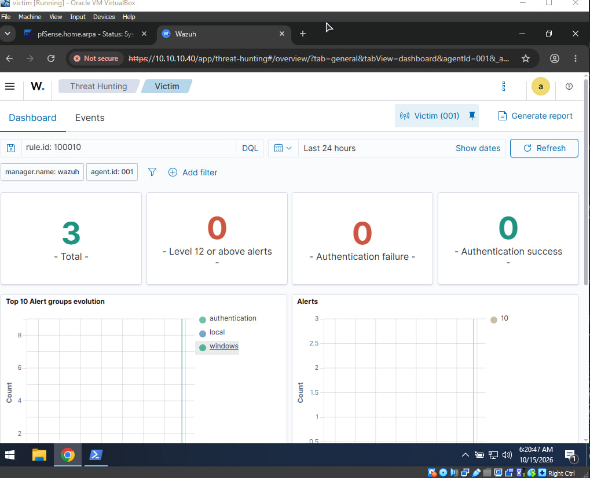
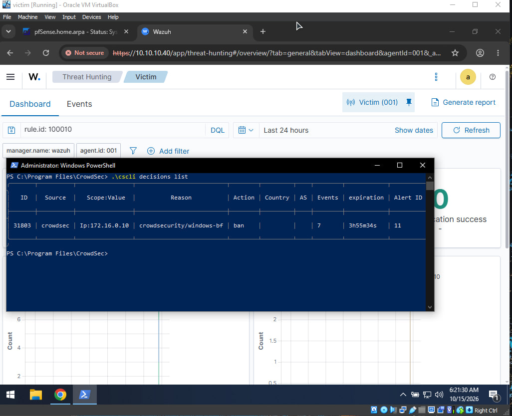
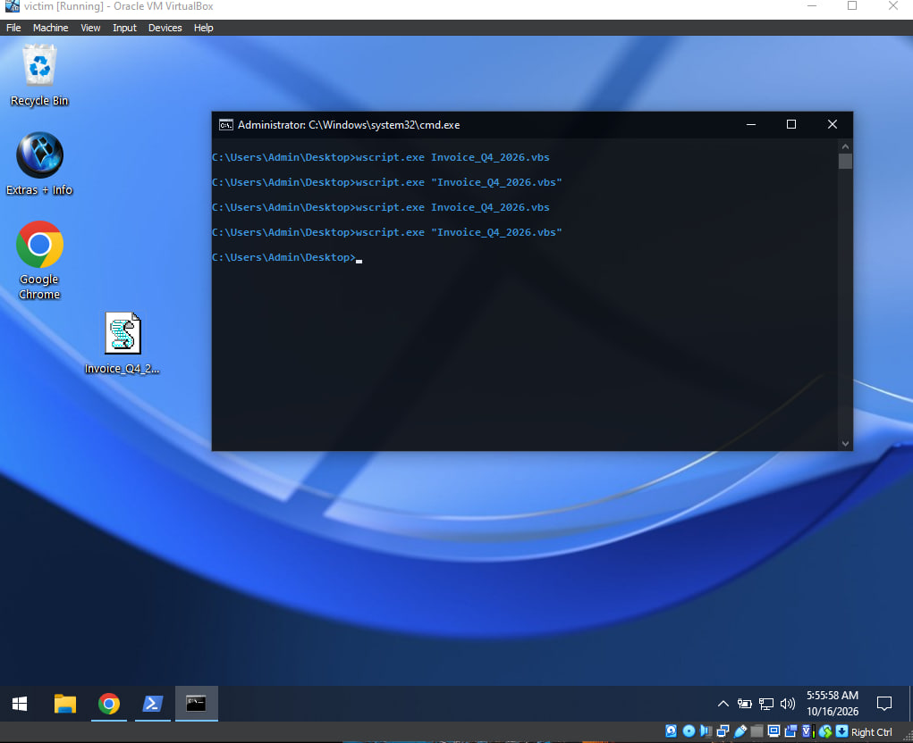
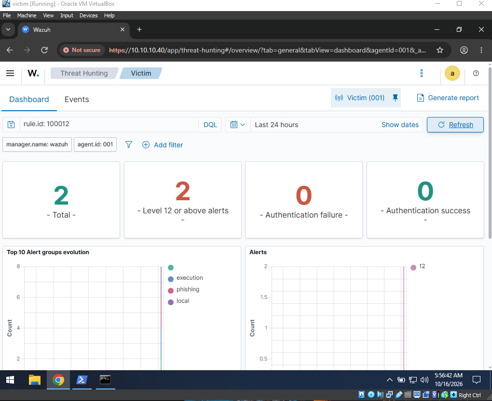
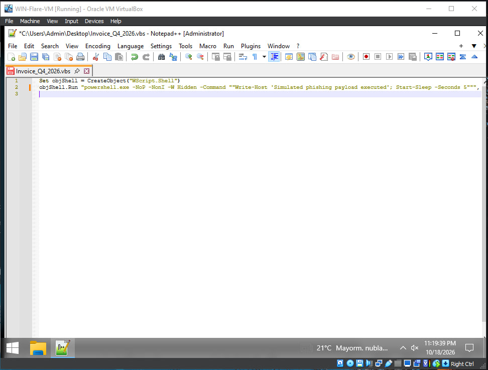

# SOC Home Lab — Multi-Stage Attack Detection & Response

## Overview

This lab simulates a small enterprise network and demonstrates detection and 
response across three attack stages: reconnaissance, credential brute-force, 
and a phishing-style execution chain. It was built to practice SOC analyst 
workflows — log correlation, rule writing, and incident investigation — using 
self-hosted, open-source tooling.

**Stack used:** Windows Server (AD), pfSense (firewall/segmentation), Kali Linux 
(attacker), Windows 10 (victim), Wazuh (SIEM), CrowdSec (IPS/auto-response), 
Sysmon (endpoint telemetry), FLARE-VM (analyst workstation).

---

## Architecture

[Insert your network diagram image here]

- **Green zone (10.10.10.0/24):** AD-SERVER, Victim, FLARE-VM
- **DMZ zone (172.16.0.0/24):** Kali (attacker)
- **pfSense:** routes/firewalls between zones, logs cross-zone traffic

I created this structure to show how firewall work in real life. The "DMZ" 
(external) connection with an attacker; the "Green zone" is the internal 
network, which must be protected from attacks. This is real filtering of 
a company's network. 

---

## Scenario 1: Reconnaissance

**What I did:**
Ran an Nmap scan from the attacker machine against the victim to simulate an 
attacker probing for open services before an attack:
```bash
nmap -sV -Pn -p 1-1000,3389,5985,445 10.10.10.20
```

**Evidence:**




**What it shows:**
Nmap identified an open RDP port 3389. pfSense captured a log of the possible 
connection to the victim's ports, which represents a recon fingerprint. After 
the scan, I noticed that the open port can be used for an attack, specifically 
in Scenario 2.

**Note:** The scan was also flagged by Wazuh’s default ruleset without 
requiring a custom rule, showing baseline detection coverage even before 
adding custom logic. Screenshot shows Wazuh alert from this custom rule:
```xml
<rule id="100011" level="7">
  <match>block</match>
  <description>pfSense firewall blocked traffic</description>
  <group>pfsense,firewall_block,</group>
  <mitre>
    <id>T1046</id>
  </mitre>
</rule>
```
This rule detects blocked firewall events triggerd by port scanning and 
MITRE technique T1046 helps when you have evidence of scanning.

**MITRE ATT&CK:** T1046 (Network Service Discovery)

---

## Scenario 2: Brute-Force Authentication Attack

**What I did:**
I created a test account and wrote a script(loop) for RDP login attempts from Kali 
using xfreerdp.
```bash
for i in {1..15}; do
  xfreerdp /v:10.10.10.20:3389 /u:testuser /p:wrongpass$i /cert:ignore +auth-only
  sleep 3
done
```

**Evidence:**





**Detection:**
I wrote a custom Wazuh rule to detect repeated failed logons:
```xml
<rule id="100010" level="10" frequency="5" timeframe="300">
  <if_matched_sid>60122</if_matched_sid>
  <description>Repeated Windows logon failures: possible brute-force activity</description>
  <mitre>
    <id>T1110</id>
  </mitre>
</rule>
```
The rule triggers when there are 5+ failed logon events in a 300-second window - 
60122 Wazuh's rule, which helps to distinguish a brute-force pattern from a user 
mistyped password.

**Response:**
CrowdSec, running on the victim, independently detected the same pattern and 
automatically banned the attacker's IP after 7 failed attempts.

**MITRE ATT&CK:** T1110 (Brute Force)

---

## Scenario 3: Phishing-Style Execution Chain

**What I did:**
I created a .vbs script that is a malicious document; when opened, it
spawns a hidden PowerShell process, similar to a real phishing payload.

```vbscript
Set objShell = CreateObject("WScript.Shell")
objShell.Run "powershell.exe -NoP -NonI -W Hidden -Command ""...""", 0, False
```

**Evidence:**




**Detection:**
```xml
<rule id="100012" level="12">
  <if_group>sysmon_eid1_detections</if_group>
  <field name="win.eventdata.parentImage" type="pcre2">(?i)wscript\.exe|cscript\.exe|cmd\.exe</field>
  <field name="win.eventdata.image" type="pcre2">(?i)powershell\.exe</field>
  <description>Suspicious script host spawning PowerShell - possible phishing payload execution</description>
  <mitre>
    <id>T1566.001</id>
    <id>T1059.005</id>
  </mitre>
</rule>
```
This rule detects any kind of scripting host, like a wscript spawning PowerShell.
Documents that can be associated with malicious script execution, no matter 
what they do. 

**Static analysis:**
I reviewed the script on FLARE-VM, an isolated analyst workstation, before/after 
execution to confirm its behavior without relying solely on dynamic detection.

**MITRE ATT&CK:** T1566.001 (Spearphishing Attachment), T1059.005 (VBScript)

---

## Investigation Summary

[Write this as if reporting to a team lead. Example skeleton:]

On (...), the lab environment detected a multi-stage simulated intrusion 
originating from 172.16.0.10 (DMZ/external-equivalent segment):

1. Reconnaissance activity (Nmap) identified RDP exposed on the victim host.
2. A brute-force attack against a local account (testuser) followed, 
   generating 7 failed authentication events within [timeframe]. 
   CrowdSec's automated response banned the source IP after 7 attempts, 
   before [did/did not] any attempt succeed.
3. Separately, a simulated phishing payload was executed on the victim, 
   triggering a PowerShell process spawned from a script host — flagged 
   immediately by the custom Wazuh rule.

**Recommendation:** [your own analyst-style conclusion — e.g., "Disable 
testuser or enforce account lockout after N failed attempts; the CrowdSec 
block mitigated further brute-force attempts but did not prevent the initial 
exposure. RDP should not be directly exposed without additional controls 
such as MFA or VPN-gated access in a production environment."]

---

## Challenges and Lessons Learned

[This section matters — be honest and specific. Examples of what to include, 
in your own words:]

- Initially planned this lab around Microsoft Sentinel, but could not obtain 
  a usable free Azure subscription. Pivoted to Wazuh, a self-hosted open-source 
  SIEM, which required a different detection-rule syntax (XML-based rules vs. KQL).
- [Describe the DNS forwarder issue on AD-SERVER — e.g., "External DNS resolution 
  failed on an internal VM because AD's DNS role had no forwarder configured; 
  diagnosed by testing DNS resolution with resolvectl and fixing via 
  Add-DnsServerForwarder."]
- [Describe the wazuh-db startup issue and how you diagnosed it via journalctl/
  manual daemon start]
- [Describe the rule-ID mismatch — your custom brute-force rule initially 
  referenced the wrong base rule ID (60105 instead of 60122); traced this by 
  checking the actual alerts.json output rather than guessing.]
- [Anything else — Whonix not working for the attacker role, the DMZ firewall 
  rule needing both TCP and UDP for the package install, etc.]


